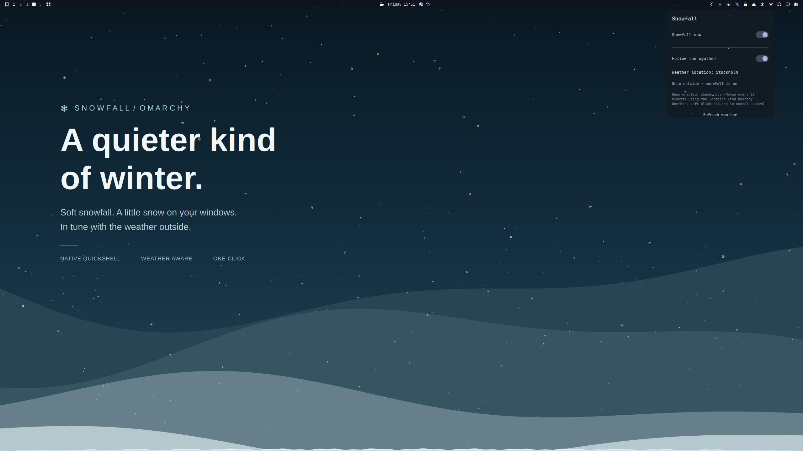

# ❄ Snowfall for Omarchy

A quieter kind of winter. Soft snowfall over your desktop, delicate snow along your windows, and an optional connection to the weather outside.



Three GPU-rendered layers drift at different speeds, with gentle wind and occasional rotating snow crystals. Small snow banks gradually form along visible window edges and the bottom of the screen. Your mouse and keyboard keep working normally through the effect.

## Install

Once this repository is published as `itsmoorgrove/omarchy-snow`:

```bash
omarchy plugin add https://github.com/itsmoorgrove/omarchy-snow --enable
```

The repository root contains the Omarchy manifest. There is no build step, install script, API key, or additional package to download. Requires Omarchy's Quickshell shell, Hyprland, QtQuick.Particles and curl, already present on the tested installation.

## Controls

| Action | Result |
| --- | --- |
| Left click ❄ | Toggle snowfall and return to manual control |
| Right click ❄ | Open the settings card |
| Snowfall now | Toggle snowfall manually |
| Follow the weather | Save automatic mode in Omarchy's shell settings |
| Refresh weather | Check the selected location immediately |
| Escape | Close the settings card |
| A / Space while the card has focus | Toggle automatic mode / snowfall |

The icon turns icy blue when snowfall or automatic mode is active. Manual snowfall starts off after a shell restart. Automatic mode survives restarts.

## Follow the weather

Choose a location in Omarchy Weather, then turn on **Follow the weather** in Snowfall. The location and coordinates are read from `~/.local/state/omarchy/settings/weather.json` and followed when changed; no location is hardcoded. Stockholm is used in the examples and preview.

While enabled, Snowfall checks [Open-Meteo](https://open-meteo.com/) every ten minutes using those coordinates. This is the same current-weather source used by Omarchy Weather for locations with coordinates, fetched separately because the weather widget does not expose a shared report API. Their refresh times can differ briefly.

Snowfall switches on for snow, snow grains and snow showers (WMO codes 71, 73, 75, 77, 85 and 86), and switches off for other conditions. This follows the current modeled weather, not the daily forecast icon or an on-site sensor. [Weather code reference](https://open-meteo.com/en/docs).

There are no weather requests while automatic mode is off. HTTPS requests have an eight-second timeout and a 16 KiB response limit. Responses, coordinates, codes and timestamps are validated. On failure, the last valid state may remain until its weather timestamp is 90 minutes old, then snowfall stops. Changing location clears the old automatic state immediately. A missing location or coordinates is explained in the settings card; no IP-based location detection is performed by this plugin.

Weather data: [Open-Meteo](https://open-meteo.com/), [CC BY 4.0](https://creativecommons.org/licenses/by/4.0/).

## Details

- At most 490 particles per screen, rendered by QtQuick.Particles.
- Snow banks grow over approximately one minute, bounded to 3.5–9 logical pixels.
- Geometry follows monitor, workspace and window changes without subprocess polling.
- Overlay input regions are empty; keyboard focus is never requested by the snowfall.
- Settings use Omarchy's native panel, colors, typography and motion preferences.
- English and Swedish catalogs follow Omarchy's live language selection.
- Switching snowfall off releases the overlay, particle system and accumulation timers.
- Reduced motion pauses the snowfall and accumulation.

Accumulation is decorative, rather than per-particle collision physics. Hyprland provides geometry and focus history rather than a complete stacking order, so occlusion uses fullscreen, special-workspace, floating state and recent focus. Unusual stacking can differ. Geometry normally settles within about 200 ms. A window leaving the visible workspace starts clean when it returns. No application content is captured or read by the plugin.

## Development

```bash
node tests/ledges.cjs
node tests/weather.cjs
omarchy plugin validate "$PWD"
```

For a local installation, copy this repository's plugin files into `~/.config/omarchy/plugins/local.snow/`, rescan with `omarchy-shell shell rescanPlugins`, then enable with `omarchy plugin enable local.snow --section right`. Discovery is asynchronous; allow it to finish before enabling. Installed files and this source directory are separate copies.

`omarchy-shell shell toggle local.snow` opens or closes the settings card. Remove the bar entry with `omarchy plugin disable local.snow`. If a hot reload retains old QML components, `omarchy restart shell` loads the current files.

Validated on 2026-11-13 with manifest validation, geometry and weather tests, and the running Omarchy shell: native settings, persisted automatic mode, live weather integration, snow rendering and input passthrough. Test coverage includes snow/rain classification, stale/future timestamps, bounds, workspace geometry, occlusion and plain-text handling of markup-shaped input.

No packages were added or changed. Tests use Node's standard library, and setup used Python's standard library, so no third-party PyPI/npm audit was needed. Existing system dependencies were not vulnerability-scanned. The preview combines the running snowfall with a temporary vector winter backdrop and an illustrative settings card for Stockholm.

MIT licensed.
